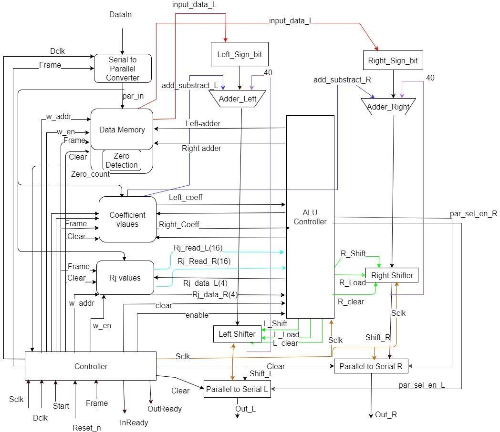
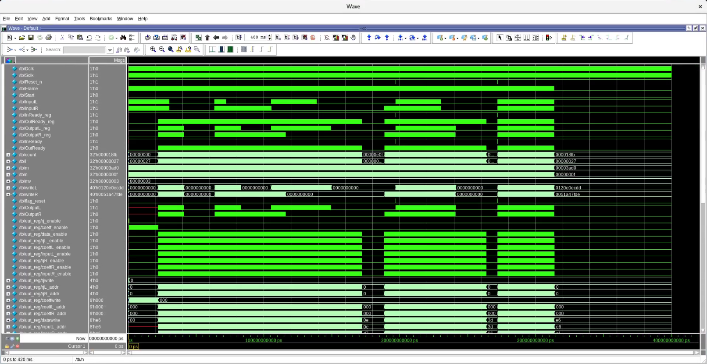

# Mini Stereo Digital Audio Processor (MSDAP) Design

This project implements a **two-channel finite impulse response (FIR) audio processor** in Verilog. The architecture handles left and right audio streams on one design, using shift-and-add/subtract operations in place of general-purpose multipliers. The original course project covered RTL design, a simulation testbench, and logic synthesis with Synopsys Design Compiler.

## Architecture



The design includes:

- **Serial input/output:** SIPO and PISO blocks receive 16-bit serial samples and transmit processed output.
- **Two-channel datapath:** Left and right channels use coefficient memory, input-data memory, an adder/subtractor, and a shift accumulator.
- **Control logic:** A main controller and an ALU controller coordinate coefficient loading, sample handling, and computation.
- **Operating modes:** Startup, loading `rj` values and coefficients, processing, reset, and sleep. The specified filter order can extend to 255.

The underlying method expresses filter coefficients using powers of two and performs convolution through a sequence of shifts and additions/subtractions rather than implementing a full multiplier for each operation. The original report discusses the algorithm and the controller states in detail.

## Files

| Folder | Contents |
|---|---|
| [`rtl/`](rtl/) | Original Verilog modules, including `top.v`, controllers, memories, adder, shift accumulator, SIPO and PISO |
| [`simulation/`](simulation/) | Original `tb.v` and `data2.txt`; optional command-line runner and script added for convenience |
| [`synthesis/constraints/`](synthesis/constraints/) | Original timing constraints (`cons.tcl` and `MSDAP.sdc`) |
| [`synthesis/reports/`](synthesis/reports/) | Synopsys Design Compiler area, cell, timing, QoR, and power reports |
| [`docs/`](docs/) | [Final project report](docs/Final_Project_Report.pdf), [presentation](docs/Final_Presentation.pptx), and extracted architecture/simulation figures |

## Synthesis results (archived, April 2023)

The values below are **as reported by Synopsys Design Compiler O-2018.06-SP1**; they are not new measurements or post-layout signoff results.

| Metric | Reported value |
|---|---:|
| Standard-cell area | 2,166,284.79 (library area units; `area.rpt`) |
| Cells | 75,258 (`area.rpt`) |
| Combinational cells | 49,651 |
| Sequential cells | 25,574 |
| Estimated dynamic power | 45.88 mW |
| Estimated leakage power | 76.16 µW |
| Setup slack, Sclk path group | +0.01 ns |
| Setup slack, Dclk path group | +0.28 ns |
| Total negative slack | 0.00 ns |

The synthesis constraint file specifies `Sclk = 39.03 ns` and `Dclk = 1302.35 ns`. The power report uses a 1.62 V slow-corner library at 125 °C and flags some switching activities as unannotated, so its power numbers should be treated as tool estimates, not measured device power.

## RTL simulation

The original testbench drives serial data from `simulation/data2.txt`, exercises reset events, and writes the stereo output words to `simulation/output2.txt`. It is a **stimulus/output-recording testbench**, not an automated, self-checking regression suite.

If you have **Icarus Verilog** installed, from the repository root:

```bash
cd simulation
bash run.sh
```

The script builds from the original Verilog files, runs a small added wrapper (`tb_runner.v`) to provide a termination condition, and writes `output2.txt` in the simulation directory. The original `tb.v` has not been edited. The command has **not been re-run or validated in the current packaging environment** because an HDL simulator was not available; see [project notes](docs/PROJECT_NOTES.md) before relying on it.

A waveform captured during the original project is shown below:



## Documentation and project context

- [Final report — design specifications, block diagrams, RTL simulation, and synthesis](docs/Final_Project_Report.pdf)
- [Final presentation](docs/Final_Presentation.pptx)
- [Project notes and limitations](docs/PROJECT_NOTES.md)
